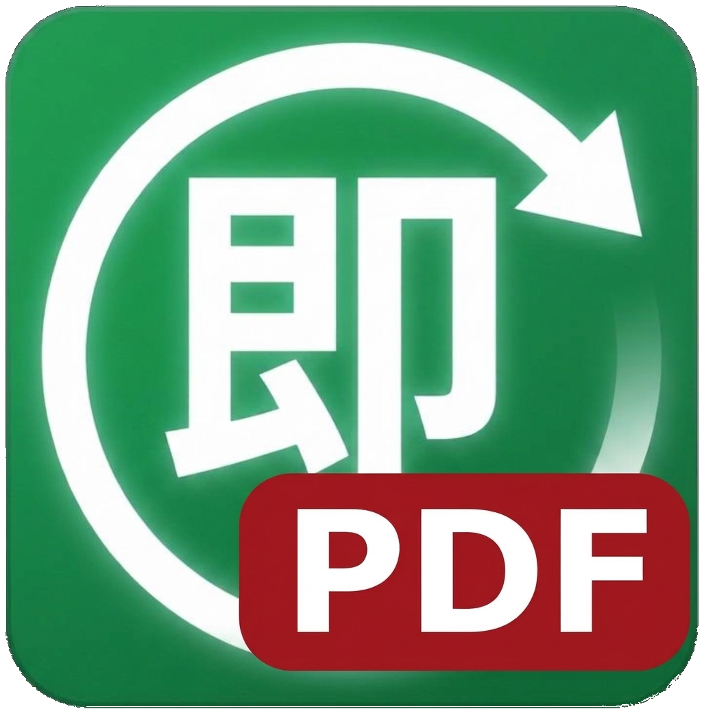

# KK_sokuPri：即PDFプリント

レイアウトエディターを開かずに、マップキャンバスの表示範囲を指定して地図をPDFへすぐに印刷できるQGISプラグインです。



- 対応バージョン: QGIS 3.40 ～ 4.99
- プラグイン名: `KK_sokuPri：即PDFプリント`
- 現在のバージョン: 0.9.2

## 主な機能

- マップキャンバス上で印刷位置を選択
- 用紙サイズと縦横方向の指定
- 指定縮尺での印刷範囲計算
- 印刷範囲のリアルタイムプレビュー
- タイトル、フォント、方位記号、スケールバー、縮尺、著作権ラベルをPDFへ出力
- 地図の回転を考慮した印刷
- 解像度の指定（72～1200 dpi）
- PDF保存先とファイル名の指定


## ボタン・操作

| ボタンまたは操作 | 動作 |
| --- | --- |
| **KK_sokuPri 即PDFプリント** | 設定パネルを開きます。ツールバーまたはプラグインメニューのボタンを押すと、パネルの表示・非表示が切り替わります。 |
| マップキャンバス上の移動 | 印刷範囲のプレビュー枠をカーソル位置へ移動します。枠は指定した縮尺・用紙サイズ・余白を反映します。 |
| マップキャンバス上の左クリック | 選択した位置で **「この範囲をPDFに出力しますか？」** を確認します。 |
| **はい** | PDF保存ダイアログを開きます。 |
| **いいえ** | PDF出力をキャンセルし、印刷範囲の選択に戻ります。 |
| 設定パネルを閉じる | 印刷範囲のプレビューとマップツールを解除します。 |

## 設定パネル

プラグインを起動すると、画面右側に **即PDFプリント** パネルが表示されます。

| 項目 | 説明 |
| --- | --- |
| **タイトル** | PDF上部中央に表示する地図タイトルです。空欄の場合はタイトルが描画されません。未指定で保存すると既定名は `KK_sokuPri.pdf` です。 |
| **フォント** | タイトルと各ラベルに使用するフォントです。QGISから利用可能なフォント一覧から選択できます。 |
| **縮尺** | 印刷縮尺です。例: `50000` を選択すると `S=1/50,000` として扱われます。プロジェクトの縮尺一覧または一般的な縮尺から選択できます。 |
| **用紙サイズ** | `A5`、`A4`、`A3`、`A2`、`A1`、`B5`、`B4`、`B3`、`B2`、`B1` から選択できます。 |
| **用紙方向** | **縦** または **横** を選択できます。 |
| **解像度** | PDFへ描画する解像度です。既定値は `300 dpi`、設定範囲は `72～1200 dpi` です。 |
| **著作権ラベル** | 地図下部右側に表示する文字です。プロジェクトの著作標識またはプロジェクト設定から自動入力される場合があります。 |

設定を変更すると、マップキャンバス上の印刷範囲プレビューがすぐに更新されます。

## PDFのレイアウト

生成されるPDFには、次の要素が配置されます。

```text
+----------------------------------+
|              タイトル            |
+----------------------------------+
|                                  |
|             地図部分             |
|                                  |
|                            方位記号 |
+----------------------------------+
| スケールバー  縮尺       著作権ラベル |
+----------------------------------+
```

- タイトルは用紙上部中央に20 ptで表示
- 地図は左右20 mm、上40 mm、下20 mmの余白を考慮して配置
- 地図の周囲に枠を描画
- 地図右上に地図回転に対応した方位記号「N」を表示
- 地図下にスケールバーと `S=1/縮尺` を表示
- 地図下部右側に著作権ラベルを表示
- 地図はラスタ画像としてPDFへ埋め込み

地図範囲は、選択した用紙サイズ、縦横方向、縮尺、地図座標系から計算されます。

## PDF作成手順

1. マップキャンバスで地図を表示します。
2. 必要に応じて地図の回転を設定します。
3. プラグインボタンを押して **即PDFプリント** パネルを開きます。
4. タイトル、フォント、縮尺、用紙サイズ、方向、解像度、著作権ラベルを設定します。
5. マップキャンバス上でカーソルを移動して印刷範囲を確認します。
6. 印刷したい位置で左クリックします。
7. 確認ダイアログで **はい** を選択します。
8. PDFの保存先とファイル名を指定します。

保存を完了すると、作成したPDFファイルのパスを知らせるダイアログが表示されます。

## 注意事項

- 縮尺欄には正の数値を入力してください。
- 不正な縮尺を指定した場合は警告が表示され、既定値 `50000` が使用されます。
- 解像度は指定範囲内に自動的に制限されます。
- 設定パネルを閉じると印刷範囲の選択ツールも解除されます。
- 暗黙の透過を維持できないため、地図はラスタでPDFへ出力します。

## 更新履歴

### 0.9.2

- QGIS 4系の起動時エラーを修正
- 地図をラスタで印刷するよう修正

### 0.9.1

- Qt 6互換性を修正

### 0.9.0

- 初版公開

詳細は [Plugins/KK_sokuPri/metadata.txt](Plugins/KK_sokuPri/metadata.txt) を参照してください。
